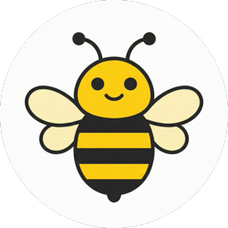
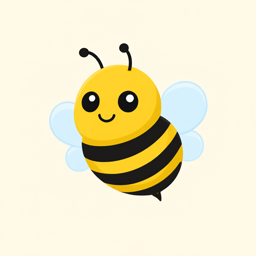

### AI 应用开发 / 全栈开发

全栈开发 · LoRA 微调 · 工作流搭建

 

---

## 关于我

熟悉 AIGC 创作类产品的开发全流程，能独立完成产品开发。

- **全栈开发** — 桌面端、Web、移动端全链路独立交付
- **自动化** — 熟悉 Playwright 框架，能针对多平台做自动化程序
- **LoRA 微调** — Z-Image、Krea2 等开源图片模型的训练与调优
- **工作流搭建** — ComfyUI 画布工作流，视频换人、动作迁移

---

## 作品

### Little Bee V2 · 桌面端

桌面端 AIGC 创作工具。一个窗口搞定创作、发布和运营 —— AI 助手对话即创作，复杂任务自己拆解、并发执行；图片、视频、语音、换人迁移都能通过与 AI 对话实现，30+ 模型直连、按量付费。

自动发布支持国内主流视频平台：抖音、快手、B 站、小红书、视频号。Agent 编排发布任务严谨 —— 单平台多账号这类账号运营任务，除用户指定外，会保证同平台一条视频只进一个账号。

### Little Bee Studio · Web 端

网页版在线工具。MiniMax H3 视频生成全系列，视频换人 / 动作迁移。同样的模型，对比即梦、LibTV 等主流 AIGC 产品更便宜。

> **Little Bee 桌面端现已免费开放。** 2026 年 7 月上线以来，7–9 月共售出 **42 份**；这 42 位用户的邮箱账号，无论 Studio 注册与否，初始积分都是 **1000 起**。由衷感谢你们给了我希望。

---

## 技术栈

---

<a href="http://www.newlbee.xyz">www.newlbee.xyz</a>

